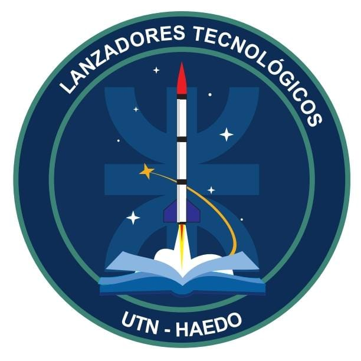

<p align="center">
  
</p>

# RocktStand - Rocket Stand Test Software

Desktop application for static rocket-motor test stands. It reads a load cell
(HX711 + Arduino) over a serial port, plots thrust in real time and exports the
measurements to text files.

Developed for the **Grupo de Lanzadores Tecnológicos (GLT)**, the university
rocketry research group of **UTN Facultad Regional Haedo** (Argentina).

## Features

- Live *Force vs Time* plot (accumulated, 10 s sliding window, or paused).
- Force shown in `N`, `kgf` or `gf`; current and peak force read-outs.
- Software tare.
- Bending or compression load cell mounting (sign inversion).
- Zero filter: the noise around zero is shown as a flat line at `0`.
- User interface in English and Spanish (**Language** menu).
- Guided single-point calibration that updates the HX711 scale factor.
- Recording of a whole session to `.txt`, flushed continuously to disk.
- Export of a selected time range of the plot to `.txt`.
- Serial ports are re-scanned automatically; no restart needed after plugging in.

## Quick start

### Option A - Windows executable

Run `RocktStand.exe` (built with `python build_exe.py`, see
[docs/building.md](docs/building.md)). No Python installation is required.

### Option B - run from source

Requires Python 3.11 or newer.

```bash
pip install -r requirements.txt
python src/main.py
```

### Firmware

Flash [`firmware/rocktstand_hx711/rocktstand_hx711.ino`](firmware/rocktstand_hx711/rocktstand_hx711.ino)
with the Arduino IDE. It needs an HX711 Arduino library that provides `HX711.h`
with `begin`, `set_scale`, `tare` and `get_units`.

| Signal              | Arduino pin |
| ------------------- | ----------- |
| HX711 `DOUT`        | `2`         |
| HX711 `CLK`         | `3`         |
| Link / watchdog LED | `A1`        |
| Recording LED       | `A3`        |

The firmware tares the load cell at power-up, so start it with no load applied.

## Using the application

1. Select the **Port** and **Baud** (the firmware uses `115200`) and press **Connect**.
2. Choose the units, the plot mode and the load cell type under **Settings**.
3. With the stand unloaded, press **Tare**.
4. Optional: press **Calibrate** and follow the wizard (see below).
5. Press **Start recording**, choose a file, run the test, then **Stop recording**.
6. To save only part of a run, press **Select X range**, drag the band over the
   plot and press **Export selected range**.

Other controls:

- **Pause reading / Resume reading** ignores incoming samples without disconnecting.
- **Clear** empties the plot and restarts the time axis (disabled while recording).
- Units, plot mode and load cell type are locked while a recording is active.
- Starting a recording clears the plot so that the file starts at `t = 0`.
- **Zero filter** (on by default, threshold `0.05 N`): readings closer to zero
  than the threshold are shown, plotted and recorded as exactly `0`, so the
  plot is a flat line with no load. Readings above it keep their exact value.
  Once at zero, a reading must exceed twice the threshold to leave it, so noise
  at the edge does not flicker. **Tare** always uses the unfiltered reading.
- **Language** menu: English or Español. The choice is saved and applies the
  next time the application starts; the first time, the system language is used.

The on-screen buffer keeps the most recent 4000 samples. The application asks
for a sample every 100 ms, but the real rate is set by the firmware (each reply
averages 3 HX711 conversions): existing logs show about 3 samples per second,
which makes the buffer roughly 20 minutes long. A recording is written directly
to disk and is not limited by that buffer; a range export is.

### Calibration

The wizard performs a single-point calibration with a reference weight:

1. Enter the known value of the reference weight. The value may carry a unit
   (`3.27 N`, `0.333 kgf`, `333 gf`); without one, the current display unit is used.
2. Tare with no load.
3. Place the reference weight and wait for the reading to settle.
4. Capture the current reading.
5. The new scale factor is computed and sent to the firmware:

```text
scale_new = scale_current * (captured_reading / known_value)
```

A change of more than 50x in either direction is rejected as a probable unit
or tare mistake.

> **The scale factor is not stored permanently.** The firmware keeps it in RAM,
> and the application assumes the firmware default (`43943.025`) every time it
> starts. After power-cycling the Arduino or restarting the application,
> calibrate again or write the new factor into the firmware source
> (`factorEscala`) and into `DEFAULT_SCALE_FACTOR` in
> `src/services/serial_worker.py`.

## Output file format

Tab-separated text, UTF-8. The header keys are in Spanish because they are the
data format already used by the group's existing files and analysis scripts.

```text
# fecha y hora = 16/03/2026 09:24
# g local =      9.8066500 m/s2
# tiempo_s    fuerza_kgf
0.000000    0.333600
0.302932    0.334000
```

| Line             | Meaning                                                  |
| ---------------- | -------------------------------------------------------- |
| `# fecha y hora` | Local date and time when the file was created            |
| `# g local`      | Gravity used for `N` <-> `kgf` / `gf` conversion         |
| `# tiempo_s`     | Column 1: seconds since the first sample of the session  |
| `fuerza_<unit>`  | Column 2: force after tare, in the unit shown in the app |

Suggested file names are `log_YYYY_MM_DD__HHh_MMmin.txt` for recordings and
`medicion_rango_YYYY_MM_DD__HHh_MMmin.txt` for range exports. Both patterns are
listed in `.gitignore` so measurement data is not committed by accident.

## Project layout

```text
src/
  main.py                  entry point
  app_info.py              name, version, organisation
  resources.py             paths of bundled data files
  domain_models.py         enums and dataclasses (no Qt, no serial)
  services/                logic without widgets (unit-tested)
    serial_worker.py         polling thread + Qt controller
    simple_protocol.py       parser for the firmware replies
    serial_port_service.py   port enumeration
    measurement_service.py   sample buffer, tare, peak force
    calibration_service.py   scale factor computation
    unit_conversion.py       N / kgf / gf conversion and input parsing
    txt_export_service.py    file format and session recorder
  ui/                      widgets
    main_window.py / .ui     main window (layout made with Qt Designer)
    calibrate_dialog.py      calibration wizard
    x_range_selection.py     range selection band on the plot
    plot_axis.py             axis with plain decimal labels
  assets/                  logo (PNG and ICO)
firmware/rocktstand_hx711/ Arduino sketch
tests/                     pytest suite
docs/                      architecture, serial protocol, build instructions
```

More detail:

- [docs/architecture.md](docs/architecture.md) - how the modules fit together.
- [docs/serial_protocol.md](docs/serial_protocol.md) - PC <-> Arduino protocol.
- [docs/building.md](docs/building.md) - tests and building the executable.

## Development

```bash
pip install -r requirements-dev.txt
python -m pytest
```

The tests run without hardware and without a display: the serial port is
replaced by a fake firmware and Qt runs in off-screen mode.

To build the Windows executable:

```bash
python build_exe.py
```

The result is `dist/RocktStand.exe`.

## Troubleshooting

| Symptom                       | Things to check                                                |
| ----------------------------- | -------------------------------------------------------------- |
| `(no ports)` in the port list | Cable, USB-serial driver, another program holding the COM port |
| Connected but no data         | Baud rate (`115200`), correct firmware flashed, HX711 wiring   |
| Readings have the wrong sign  | Switch **Load cell type** between Bending and Compression      |
| Readings are off by a factor  | Run the calibration wizard                                     |
| Calibrate button disabled     | It is enabled only while connected                             |

## License

Released under the [MIT License](LICENSE). Copyright (c) 2026 Leonardo Lopez - Anibal Vettorel.

The logo belongs to the Grupo de Lanzadores Tecnológicos - UTN Haedo.
